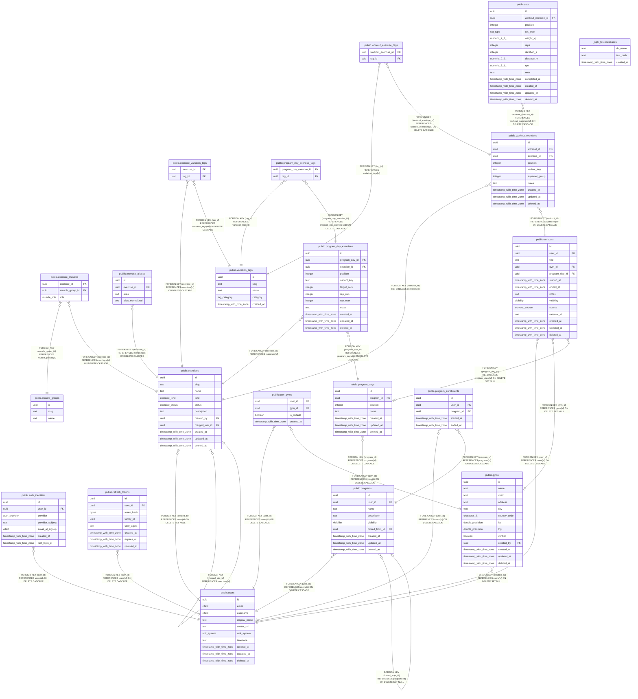

# metamorph

## Viewpoints

| Name | Description |
| ---- | ----------- |
| [Auth](viewpoint-0.md) | Accounts, linked OAuth identities and sessions. |
| [Exercise catalog](viewpoint-1.md) | Canonical exercises, muscles, aliases and stackable variation tags. |
| [Workout logging](viewpoint-2.md) | Workouts, their exercises (with stacked tags), sets and gyms. |
| [Programs](viewpoint-3.md) | Splits, their days and target exercises, and enrollments. |
| [Gyms](viewpoint-4.md) | Gym directory and users' saved gyms. |

## Tables

| Name | Columns | Comment | Type |
| ---- | ------- | ------- | ---- |
| [public.users](public.users.md) | 10 | Application accounts. Identity proof lives in auth_identities, not here. | BASE TABLE |
| [public.auth_identities](public.auth_identities.md) | 7 | One row per linked OAuth account. A user may link several providers. | BASE TABLE |
| [public.refresh_tokens](public.refresh_tokens.md) | 8 | Our own session tokens, issued after OAuth verification. Only a hash is stored. | BASE TABLE |
| [public.muscle_groups](public.muscle_groups.md) | 3 | Reference list of muscle groups (chest, lats, quads, ...). | BASE TABLE |
| [public.exercises](public.exercises.md) | 11 | Canonical exercises, e.g. "Lat Pulldown". Variations are tags, not separate exercises. | BASE TABLE |
| [public.exercise_muscles](public.exercise_muscles.md) | 3 |  | BASE TABLE |
| [public.exercise_aliases](public.exercise_aliases.md) | 4 | Alternate names ("Lat Pulldowns") that resolve to a canonical exercise. Globally unique once normalised. | BASE TABLE |
| [public.variation_tags](public.variation_tags.md) | 5 | Stackable modifiers (cable, v-bar, neutral grip). Slugs are immutable: they feed variant_key. | BASE TABLE |
| [public.exercise_variation_tags](public.exercise_variation_tags.md) | 2 | Optional: tags suggested in the UI for an exercise. Not a restriction. | BASE TABLE |
| [public.gyms](public.gyms.md) | 13 | Shared gym directory, e.g. "Golds Gym, Aundh". Plain lat/lng for now; PostGIS only if "gyms near me" needs it. | BASE TABLE |
| [public.user_gyms](public.user_gyms.md) | 4 | A user's saved gyms. Doubles as gym membership for later social features. | BASE TABLE |
| [public.programs](public.programs.md) | 9 | A split, e.g. "Push / Pull / Legs". forked_from_id supports copying a friend's program later. | BASE TABLE |
| [public.program_days](public.program_days.md) | 7 |  | BASE TABLE |
| [public.program_day_exercises](public.program_day_exercises.md) | 12 |  | BASE TABLE |
| [public.program_day_exercise_tags](public.program_day_exercise_tags.md) | 2 |  | BASE TABLE |
| [public.program_enrollments](public.program_enrollments.md) | 5 | Which program a user is currently following. At most one active row per user. | BASE TABLE |
| [public.workouts](public.workouts.md) | 14 | One training session. Day bucketing (heatmap, streaks) uses started_at in users.timezone. | BASE TABLE |
| [public.workout_exercises](public.workout_exercises.md) | 10 |  | BASE TABLE |
| [public.workout_exercise_tags](public.workout_exercise_tags.md) | 2 |  | BASE TABLE |
| [public.sets](public.sets.md) | 14 | Individual sets. Which of weight/reps/duration/distance are required depends on exercises.kind; enforced in the API. | BASE TABLE |
| [_sqlx_test.databases](_sqlx_test.databases.md) | 3 |  | BASE TABLE |

## Stored procedures and functions

| Name | ReturnType | Arguments | Type |
| ---- | ------- | ------- | ---- |
| public.citextin | citext | cstring | FUNCTION |
| public.citextout | cstring | citext | FUNCTION |
| public.citextrecv | citext | internal | FUNCTION |
| public.citextsend | bytea | citext | FUNCTION |
| public.citext | citext | character | FUNCTION |
| public.citext | citext | boolean | FUNCTION |
| public.citext | citext | inet | FUNCTION |
| public.citext_eq | bool | citext, citext | FUNCTION |
| public.citext_ne | bool | citext, citext | FUNCTION |
| public.citext_lt | bool | citext, citext | FUNCTION |
| public.citext_le | bool | citext, citext | FUNCTION |
| public.citext_gt | bool | citext, citext | FUNCTION |
| public.citext_ge | bool | citext, citext | FUNCTION |
| public.citext_cmp | int4 | citext, citext | FUNCTION |
| public.citext_hash | int4 | citext | FUNCTION |
| public.citext_smaller | citext | citext, citext | FUNCTION |
| public.citext_larger | citext | citext, citext | FUNCTION |
| public.min | citext | citext | a |
| public.max | citext | citext | a |
| public.texticlike | bool | citext, citext | FUNCTION |
| public.texticnlike | bool | citext, citext | FUNCTION |
| public.texticregexeq | bool | citext, citext | FUNCTION |
| public.texticregexne | bool | citext, citext | FUNCTION |
| public.texticlike | bool | citext, text | FUNCTION |
| public.texticnlike | bool | citext, text | FUNCTION |
| public.texticregexeq | bool | citext, text | FUNCTION |
| public.texticregexne | bool | citext, text | FUNCTION |
| public.regexp_match | _text | string citext, pattern citext | FUNCTION |
| public.regexp_match | _text | string citext, pattern citext, flags text | FUNCTION |
| public.regexp_matches | _text | string citext, pattern citext | FUNCTION |
| public.regexp_matches | _text | string citext, pattern citext, flags text | FUNCTION |
| public.regexp_replace | text | string citext, pattern citext, replacement text | FUNCTION |
| public.regexp_replace | text | string citext, pattern citext, replacement text, flags text | FUNCTION |
| public.regexp_split_to_array | _text | string citext, pattern citext | FUNCTION |
| public.regexp_split_to_array | _text | string citext, pattern citext, flags text | FUNCTION |
| public.regexp_split_to_table | text | string citext, pattern citext | FUNCTION |
| public.regexp_split_to_table | text | string citext, pattern citext, flags text | FUNCTION |
| public.strpos | int4 | citext, citext | FUNCTION |
| public.replace | text | citext, citext, citext | FUNCTION |
| public.split_part | text | citext, citext, integer | FUNCTION |
| public.translate | text | citext, citext, text | FUNCTION |
| public.citext_pattern_lt | bool | citext, citext | FUNCTION |
| public.citext_pattern_le | bool | citext, citext | FUNCTION |
| public.citext_pattern_gt | bool | citext, citext | FUNCTION |
| public.citext_pattern_ge | bool | citext, citext | FUNCTION |
| public.citext_pattern_cmp | int4 | citext, citext | FUNCTION |
| public.citext_hash_extended | int8 | citext, bigint | FUNCTION |
| public.set_limit | float4 | real | FUNCTION |
| public.show_limit | float4 |  | FUNCTION |
| public.show_trgm | _text | text | FUNCTION |
| public.similarity | float4 | text, text | FUNCTION |
| public.similarity_op | bool | text, text | FUNCTION |
| public.word_similarity | float4 | text, text | FUNCTION |
| public.word_similarity_op | bool | text, text | FUNCTION |
| public.word_similarity_commutator_op | bool | text, text | FUNCTION |
| public.similarity_dist | float4 | text, text | FUNCTION |
| public.word_similarity_dist_op | float4 | text, text | FUNCTION |
| public.word_similarity_dist_commutator_op | float4 | text, text | FUNCTION |
| public.gtrgm_in | gtrgm | cstring | FUNCTION |
| public.gtrgm_out | cstring | gtrgm | FUNCTION |
| public.gtrgm_consistent | bool | internal, text, smallint, oid, internal | FUNCTION |
| public.gtrgm_distance | float8 | internal, text, smallint, oid, internal | FUNCTION |
| public.gtrgm_compress | internal | internal | FUNCTION |
| public.gtrgm_decompress | internal | internal | FUNCTION |
| public.gtrgm_penalty | internal | internal, internal, internal | FUNCTION |
| public.gtrgm_picksplit | internal | internal, internal | FUNCTION |
| public.gtrgm_union | gtrgm | internal, internal | FUNCTION |
| public.gtrgm_same | internal | gtrgm, gtrgm, internal | FUNCTION |
| public.gin_extract_value_trgm | internal | text, internal | FUNCTION |
| public.gin_extract_query_trgm | internal | text, internal, smallint, internal, internal, internal, internal | FUNCTION |
| public.gin_trgm_consistent | bool | internal, smallint, text, integer, internal, internal, internal, internal | FUNCTION |
| public.gin_trgm_triconsistent | char | internal, smallint, text, integer, internal, internal, internal | FUNCTION |
| public.strict_word_similarity | float4 | text, text | FUNCTION |
| public.strict_word_similarity_op | bool | text, text | FUNCTION |
| public.strict_word_similarity_commutator_op | bool | text, text | FUNCTION |
| public.strict_word_similarity_dist_op | float4 | text, text | FUNCTION |
| public.strict_word_similarity_dist_commutator_op | float4 | text, text | FUNCTION |
| public.gtrgm_options | void | internal | FUNCTION |
| public.set_updated_at | trigger |  | FUNCTION |
| public.refresh_program_day_exercise_variant_key | trigger |  | FUNCTION |
| public.refresh_workout_exercise_variant_key | trigger |  | FUNCTION |

## Enums

| Name | Values |
| ---- | ------- |
| public.auth_provider | apple, github, google |
| public.exercise_kind | bodyweight_reps, distance, duration, weight_reps |
| public.exercise_status | official, pending_review, user |
| public.muscle_role | primary, secondary |
| public.set_type | drop, failure, warmup, working |
| public.tag_category | angle, equipment, grip, other, stance |
| public.unit_system | imperial, metric |
| public.visibility | friends, private, public |
| public.workout_source | excel_import, manual |

## Relations

---

> Generated by [tbls](https://github.com/k1LoW/tbls)
