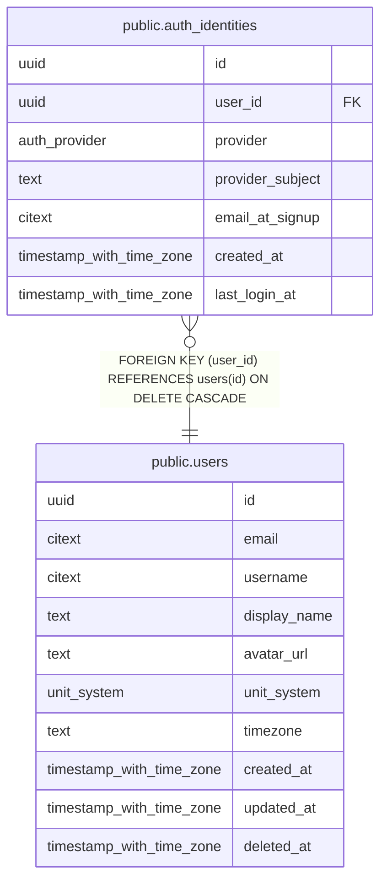

# public.auth_identities

## Description

One row per linked OAuth account. A user may link several providers.

## Columns

| Name | Type | Default | Nullable | Children | Parents | Comment |
| ---- | ---- | ------- | -------- | -------- | ------- | ------- |
| id | uuid | uuidv7() | false |  |  |  |
| user_id | uuid |  | false |  | [public.users](public.users.md) |  |
| provider | auth_provider |  | false |  |  |  |
| provider_subject | text |  | false |  |  | The provider's stable "sub" claim. Never key on email, which can change. |
| email_at_signup | citext |  | true |  |  |  |
| created_at | timestamp with time zone | now() | false |  |  |  |
| last_login_at | timestamp with time zone |  | true |  |  |  |

## Viewpoints

| Name | Definition |
| ---- | ---------- |
| [Auth](viewpoint-0.md) | Accounts, linked OAuth identities and sessions. |

## Constraints

| Name | Type | Definition |
| ---- | ---- | ---------- |
| auth_identities_created_at_not_null | n | NOT NULL created_at |
| auth_identities_id_not_null | n | NOT NULL id |
| auth_identities_provider_not_null | n | NOT NULL provider |
| auth_identities_provider_subject_not_null | n | NOT NULL provider_subject |
| auth_identities_user_id_not_null | n | NOT NULL user_id |
| auth_identities_user_id_fkey | FOREIGN KEY | FOREIGN KEY (user_id) REFERENCES users(id) ON DELETE CASCADE |
| auth_identities_pkey | PRIMARY KEY | PRIMARY KEY (id) |
| auth_identities_provider_provider_subject_key | UNIQUE | UNIQUE (provider, provider_subject) |

## Indexes

| Name | Definition |
| ---- | ---------- |
| auth_identities_pkey | CREATE UNIQUE INDEX auth_identities_pkey ON public.auth_identities USING btree (id) |
| auth_identities_provider_provider_subject_key | CREATE UNIQUE INDEX auth_identities_provider_provider_subject_key ON public.auth_identities USING btree (provider, provider_subject) |
| auth_identities_user_id_idx | CREATE INDEX auth_identities_user_id_idx ON public.auth_identities USING btree (user_id) |

## Relations

---

> Generated by [tbls](https://github.com/k1LoW/tbls)
