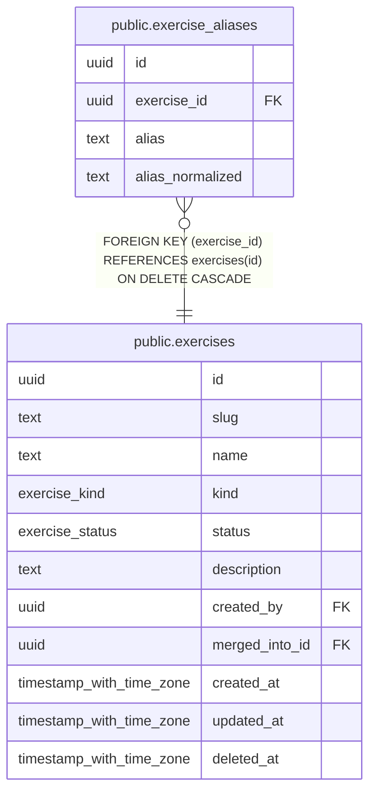

# public.exercise_aliases

## Description

Alternate names ("Lat Pulldowns") that resolve to a canonical exercise. Globally unique once normalised.

## Columns

| Name | Type | Default | Nullable | Extra Definition | Children | Parents | Comment |
| ---- | ---- | ------- | -------- | ---------------- | -------- | ------- | ------- |
| id | uuid | uuidv7() | false |  |  |  |  |
| exercise_id | uuid |  | false |  |  | [public.exercises](public.exercises.md) |  |
| alias | text |  | false |  |  |  |  |
| alias_normalized | text |  | true | GENERATED ALWAYS AS btrim(lower(regexp_replace(alias, '[^[:alnum:]]+'::text, ' '::text, 'g'::text))) STORED |  |  |  |

## Viewpoints

| Name | Definition |
| ---- | ---------- |
| [Exercise catalog](viewpoint-1.md) | Canonical exercises, muscles, aliases and stackable variation tags. |

## Constraints

| Name | Type | Definition |
| ---- | ---- | ---------- |
| exercise_aliases_alias_not_null | n | NOT NULL alias |
| exercise_aliases_exercise_id_not_null | n | NOT NULL exercise_id |
| exercise_aliases_id_not_null | n | NOT NULL id |
| exercise_aliases_exercise_id_fkey | FOREIGN KEY | FOREIGN KEY (exercise_id) REFERENCES exercises(id) ON DELETE CASCADE |
| exercise_aliases_pkey | PRIMARY KEY | PRIMARY KEY (id) |
| exercise_aliases_alias_normalized_key | UNIQUE | UNIQUE (alias_normalized) |

## Indexes

| Name | Definition |
| ---- | ---------- |
| exercise_aliases_pkey | CREATE UNIQUE INDEX exercise_aliases_pkey ON public.exercise_aliases USING btree (id) |
| exercise_aliases_alias_normalized_key | CREATE UNIQUE INDEX exercise_aliases_alias_normalized_key ON public.exercise_aliases USING btree (alias_normalized) |
| exercise_aliases_exercise_idx | CREATE INDEX exercise_aliases_exercise_idx ON public.exercise_aliases USING btree (exercise_id) |
| exercise_aliases_trgm_idx | CREATE INDEX exercise_aliases_trgm_idx ON public.exercise_aliases USING gin (alias_normalized gin_trgm_ops) |

## Relations

---

> Generated by [tbls](https://github.com/k1LoW/tbls)
