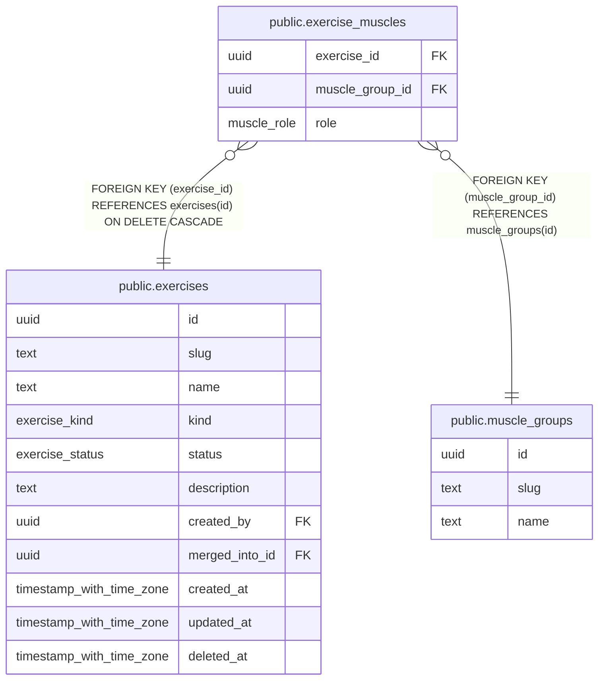

# public.exercise_muscles

## Columns

| Name | Type | Default | Nullable | Children | Parents | Comment |
| ---- | ---- | ------- | -------- | -------- | ------- | ------- |
| exercise_id | uuid |  | false |  | [public.exercises](public.exercises.md) |  |
| muscle_group_id | uuid |  | false |  | [public.muscle_groups](public.muscle_groups.md) |  |
| role | muscle_role |  | false |  |  |  |

## Viewpoints

| Name | Definition |
| ---- | ---------- |
| [Exercise catalog](viewpoint-1.md) | Canonical exercises, muscles, aliases and stackable variation tags. |

## Constraints

| Name | Type | Definition |
| ---- | ---- | ---------- |
| exercise_muscles_exercise_id_not_null | n | NOT NULL exercise_id |
| exercise_muscles_muscle_group_id_not_null | n | NOT NULL muscle_group_id |
| exercise_muscles_role_not_null | n | NOT NULL role |
| exercise_muscles_muscle_group_id_fkey | FOREIGN KEY | FOREIGN KEY (muscle_group_id) REFERENCES muscle_groups(id) |
| exercise_muscles_exercise_id_fkey | FOREIGN KEY | FOREIGN KEY (exercise_id) REFERENCES exercises(id) ON DELETE CASCADE |
| exercise_muscles_pkey | PRIMARY KEY | PRIMARY KEY (exercise_id, muscle_group_id) |

## Indexes

| Name | Definition |
| ---- | ---------- |
| exercise_muscles_pkey | CREATE UNIQUE INDEX exercise_muscles_pkey ON public.exercise_muscles USING btree (exercise_id, muscle_group_id) |
| exercise_muscles_muscle_idx | CREATE INDEX exercise_muscles_muscle_idx ON public.exercise_muscles USING btree (muscle_group_id) |

## Relations

---

> Generated by [tbls](https://github.com/k1LoW/tbls)
