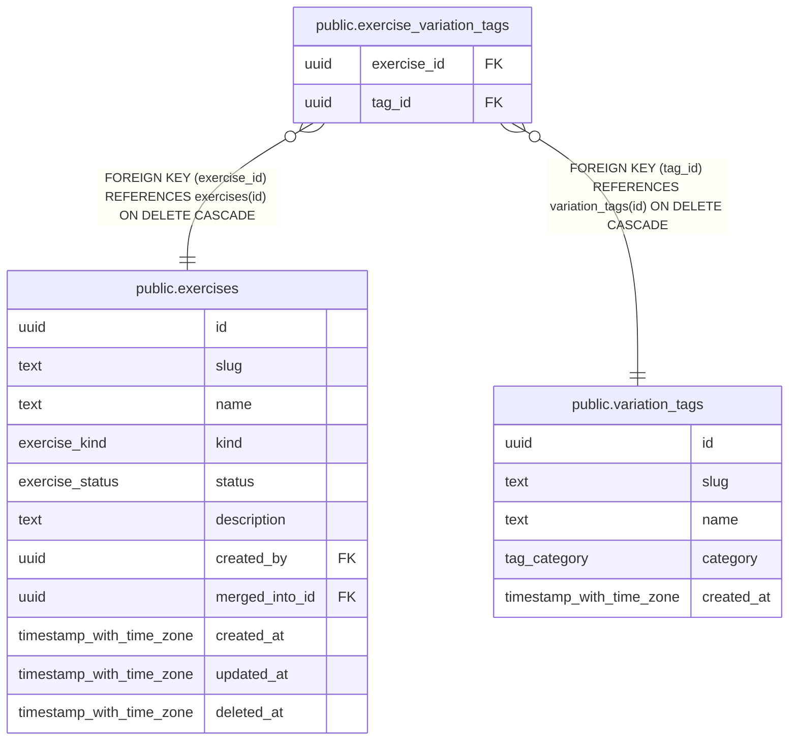

# public.exercise_variation_tags

## Description

Optional: tags suggested in the UI for an exercise. Not a restriction.

## Columns

| Name | Type | Default | Nullable | Children | Parents | Comment |
| ---- | ---- | ------- | -------- | -------- | ------- | ------- |
| exercise_id | uuid |  | false |  | [public.exercises](public.exercises.md) |  |
| tag_id | uuid |  | false |  | [public.variation_tags](public.variation_tags.md) |  |

## Viewpoints

| Name | Definition |
| ---- | ---------- |
| [Exercise catalog](viewpoint-1.md) | Canonical exercises, muscles, aliases and stackable variation tags. |

## Constraints

| Name | Type | Definition |
| ---- | ---- | ---------- |
| exercise_variation_tags_exercise_id_not_null | n | NOT NULL exercise_id |
| exercise_variation_tags_tag_id_not_null | n | NOT NULL tag_id |
| exercise_variation_tags_exercise_id_fkey | FOREIGN KEY | FOREIGN KEY (exercise_id) REFERENCES exercises(id) ON DELETE CASCADE |
| exercise_variation_tags_tag_id_fkey | FOREIGN KEY | FOREIGN KEY (tag_id) REFERENCES variation_tags(id) ON DELETE CASCADE |
| exercise_variation_tags_pkey | PRIMARY KEY | PRIMARY KEY (exercise_id, tag_id) |

## Indexes

| Name | Definition |
| ---- | ---------- |
| exercise_variation_tags_pkey | CREATE UNIQUE INDEX exercise_variation_tags_pkey ON public.exercise_variation_tags USING btree (exercise_id, tag_id) |
| exercise_variation_tags_tag_idx | CREATE INDEX exercise_variation_tags_tag_idx ON public.exercise_variation_tags USING btree (tag_id) |

## Relations

---

> Generated by [tbls](https://github.com/k1LoW/tbls)
