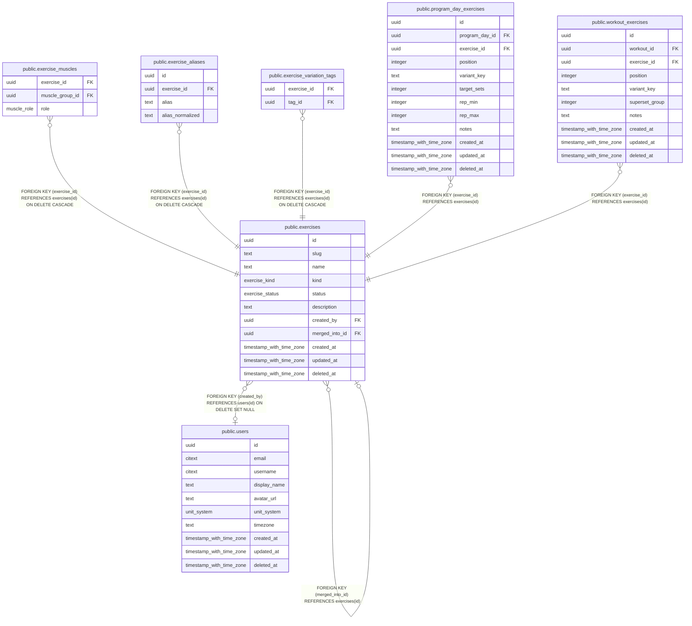

# public.exercises

## Description

Canonical exercises, e.g. "Lat Pulldown". Variations are tags, not separate exercises.

## Columns

| Name | Type | Default | Nullable | Children | Parents | Comment |
| ---- | ---- | ------- | -------- | -------- | ------- | ------- |
| id | uuid | uuidv7() | false | [public.exercises](public.exercises.md) [public.exercise_muscles](public.exercise_muscles.md) [public.exercise_aliases](public.exercise_aliases.md) [public.exercise_variation_tags](public.exercise_variation_tags.md) [public.program_day_exercises](public.program_day_exercises.md) [public.workout_exercises](public.workout_exercises.md) |  |  |
| slug | text |  | true |  |  |  |
| name | text |  | false |  |  |  |
| kind | exercise_kind |  | false |  |  |  |
| status | exercise_status | 'user'::exercise_status | false |  |  | official = curated catalog; user = private to created_by; pending_review = user exercise proposed for promotion. |
| description | text |  | true |  |  |  |
| created_by | uuid |  | true |  | [public.users](public.users.md) |  |
| merged_into_id | uuid |  | true |  | [public.exercises](public.exercises.md) | Set when a duplicate is collapsed into another exercise. Readers follow the pointer; history is never rewritten. |
| created_at | timestamp with time zone | now() | false |  |  |  |
| updated_at | timestamp with time zone | now() | false |  |  |  |
| deleted_at | timestamp with time zone |  | true |  |  |  |

## Viewpoints

| Name | Definition |
| ---- | ---------- |
| [Exercise catalog](viewpoint-1.md) | Canonical exercises, muscles, aliases and stackable variation tags. |
| [Workout logging](viewpoint-2.md) | Workouts, their exercises (with stacked tags), sets and gyms. |
| [Programs](viewpoint-3.md) | Splits, their days and target exercises, and enrollments. |

## Constraints

| Name | Type | Definition |
| ---- | ---- | ---------- |
| exercises_check | CHECK | CHECK (((status <> 'official'::exercise_status) OR (slug IS NOT NULL))) |
| exercises_check1 | CHECK | CHECK (((status <> 'user'::exercise_status) OR (created_by IS NOT NULL))) |
| exercises_check2 | CHECK | CHECK (((merged_into_id IS NULL) OR (merged_into_id <> id))) |
| exercises_created_at_not_null | n | NOT NULL created_at |
| exercises_id_not_null | n | NOT NULL id |
| exercises_kind_not_null | n | NOT NULL kind |
| exercises_name_not_null | n | NOT NULL name |
| exercises_status_not_null | n | NOT NULL status |
| exercises_updated_at_not_null | n | NOT NULL updated_at |
| exercises_created_by_fkey | FOREIGN KEY | FOREIGN KEY (created_by) REFERENCES users(id) ON DELETE SET NULL |
| exercises_merged_into_id_fkey | FOREIGN KEY | FOREIGN KEY (merged_into_id) REFERENCES exercises(id) |
| exercises_pkey | PRIMARY KEY | PRIMARY KEY (id) |
| exercises_slug_key | UNIQUE | UNIQUE (slug) |

## Indexes

| Name | Definition |
| ---- | ---------- |
| exercises_pkey | CREATE UNIQUE INDEX exercises_pkey ON public.exercises USING btree (id) |
| exercises_slug_key | CREATE UNIQUE INDEX exercises_slug_key ON public.exercises USING btree (slug) |
| exercises_name_trgm_idx | CREATE INDEX exercises_name_trgm_idx ON public.exercises USING gin (name gin_trgm_ops) |
| exercises_created_by_idx | CREATE INDEX exercises_created_by_idx ON public.exercises USING btree (created_by) |
| exercises_merged_into_idx | CREATE INDEX exercises_merged_into_idx ON public.exercises USING btree (merged_into_id) WHERE (merged_into_id IS NOT NULL) |

## Triggers

| Name | Definition |
| ---- | ---------- |
| exercises_set_updated_at | CREATE TRIGGER exercises_set_updated_at BEFORE UPDATE ON public.exercises FOR EACH ROW EXECUTE FUNCTION set_updated_at() |

## Relations

---

> Generated by [tbls](https://github.com/k1LoW/tbls)
