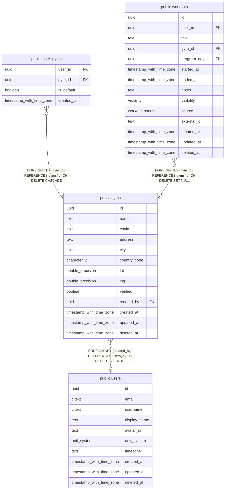

# public.gyms

## Description

Shared gym directory, e.g. "Golds Gym, Aundh". Plain lat/lng for now; PostGIS only if "gyms near me" needs it.

## Columns

| Name | Type | Default | Nullable | Children | Parents | Comment |
| ---- | ---- | ------- | -------- | -------- | ------- | ------- |
| id | uuid | uuidv7() | false | [public.user_gyms](public.user_gyms.md) [public.workouts](public.workouts.md) |  |  |
| name | text |  | false |  |  |  |
| chain | text |  | true |  |  |  |
| address | text |  | true |  |  |  |
| city | text |  | true |  |  |  |
| country_code | character(2) |  | true |  |  |  |
| lat | double precision |  | true |  |  |  |
| lng | double precision |  | true |  |  |  |
| verified | boolean | false | false |  |  |  |
| created_by | uuid |  | true |  | [public.users](public.users.md) |  |
| created_at | timestamp with time zone | now() | false |  |  |  |
| updated_at | timestamp with time zone | now() | false |  |  |  |
| deleted_at | timestamp with time zone |  | true |  |  |  |

## Viewpoints

| Name | Definition |
| ---- | ---------- |
| [Workout logging](viewpoint-2.md) | Workouts, their exercises (with stacked tags), sets and gyms. |
| [Gyms](viewpoint-4.md) | Gym directory and users' saved gyms. |

## Constraints

| Name | Type | Definition |
| ---- | ---- | ---------- |
| gyms_check | CHECK | CHECK (((lat IS NULL) = (lng IS NULL))) |
| gyms_created_at_not_null | n | NOT NULL created_at |
| gyms_id_not_null | n | NOT NULL id |
| gyms_lat_check | CHECK | CHECK (((lat >= ('-90'::integer)::double precision) AND (lat <= (90)::double precision))) |
| gyms_lng_check | CHECK | CHECK (((lng >= ('-180'::integer)::double precision) AND (lng <= (180)::double precision))) |
| gyms_name_not_null | n | NOT NULL name |
| gyms_updated_at_not_null | n | NOT NULL updated_at |
| gyms_verified_not_null | n | NOT NULL verified |
| gyms_created_by_fkey | FOREIGN KEY | FOREIGN KEY (created_by) REFERENCES users(id) ON DELETE SET NULL |
| gyms_pkey | PRIMARY KEY | PRIMARY KEY (id) |

## Indexes

| Name | Definition |
| ---- | ---------- |
| gyms_pkey | CREATE UNIQUE INDEX gyms_pkey ON public.gyms USING btree (id) |
| gyms_name_trgm_idx | CREATE INDEX gyms_name_trgm_idx ON public.gyms USING gin (name gin_trgm_ops) |
| gyms_city_idx | CREATE INDEX gyms_city_idx ON public.gyms USING btree (city) |

## Triggers

| Name | Definition |
| ---- | ---------- |
| gyms_set_updated_at | CREATE TRIGGER gyms_set_updated_at BEFORE UPDATE ON public.gyms FOR EACH ROW EXECUTE FUNCTION set_updated_at() |

## Relations

---

> Generated by [tbls](https://github.com/k1LoW/tbls)
