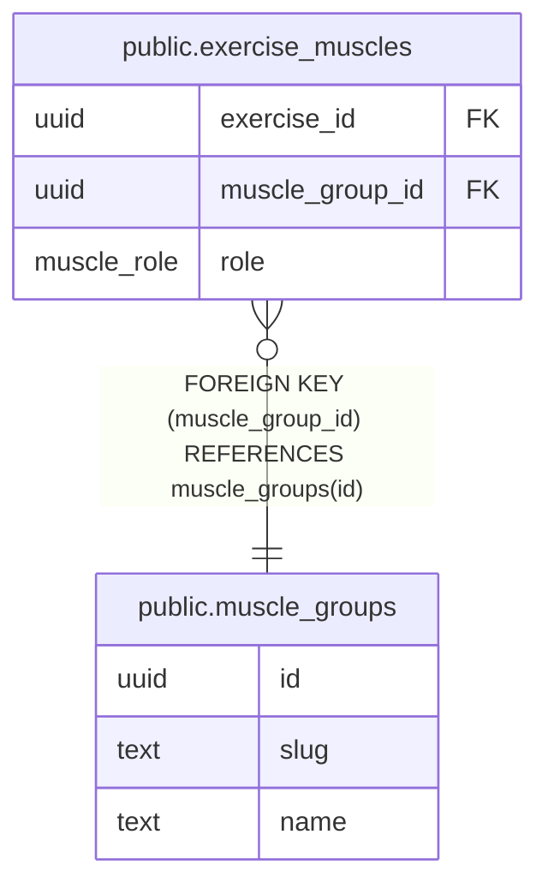

# public.muscle_groups

## Description

Reference list of muscle groups (chest, lats, quads, ...).

## Columns

| Name | Type | Default | Nullable | Children | Parents | Comment |
| ---- | ---- | ------- | -------- | -------- | ------- | ------- |
| id | uuid | uuidv7() | false | [public.exercise_muscles](public.exercise_muscles.md) |  |  |
| slug | text |  | false |  |  |  |
| name | text |  | false |  |  |  |

## Viewpoints

| Name | Definition |
| ---- | ---------- |
| [Exercise catalog](viewpoint-1.md) | Canonical exercises, muscles, aliases and stackable variation tags. |

## Constraints

| Name | Type | Definition |
| ---- | ---- | ---------- |
| muscle_groups_id_not_null | n | NOT NULL id |
| muscle_groups_name_not_null | n | NOT NULL name |
| muscle_groups_slug_not_null | n | NOT NULL slug |
| muscle_groups_pkey | PRIMARY KEY | PRIMARY KEY (id) |
| muscle_groups_slug_key | UNIQUE | UNIQUE (slug) |

## Indexes

| Name | Definition |
| ---- | ---------- |
| muscle_groups_pkey | CREATE UNIQUE INDEX muscle_groups_pkey ON public.muscle_groups USING btree (id) |
| muscle_groups_slug_key | CREATE UNIQUE INDEX muscle_groups_slug_key ON public.muscle_groups USING btree (slug) |

## Relations

---

> Generated by [tbls](https://github.com/k1LoW/tbls)
