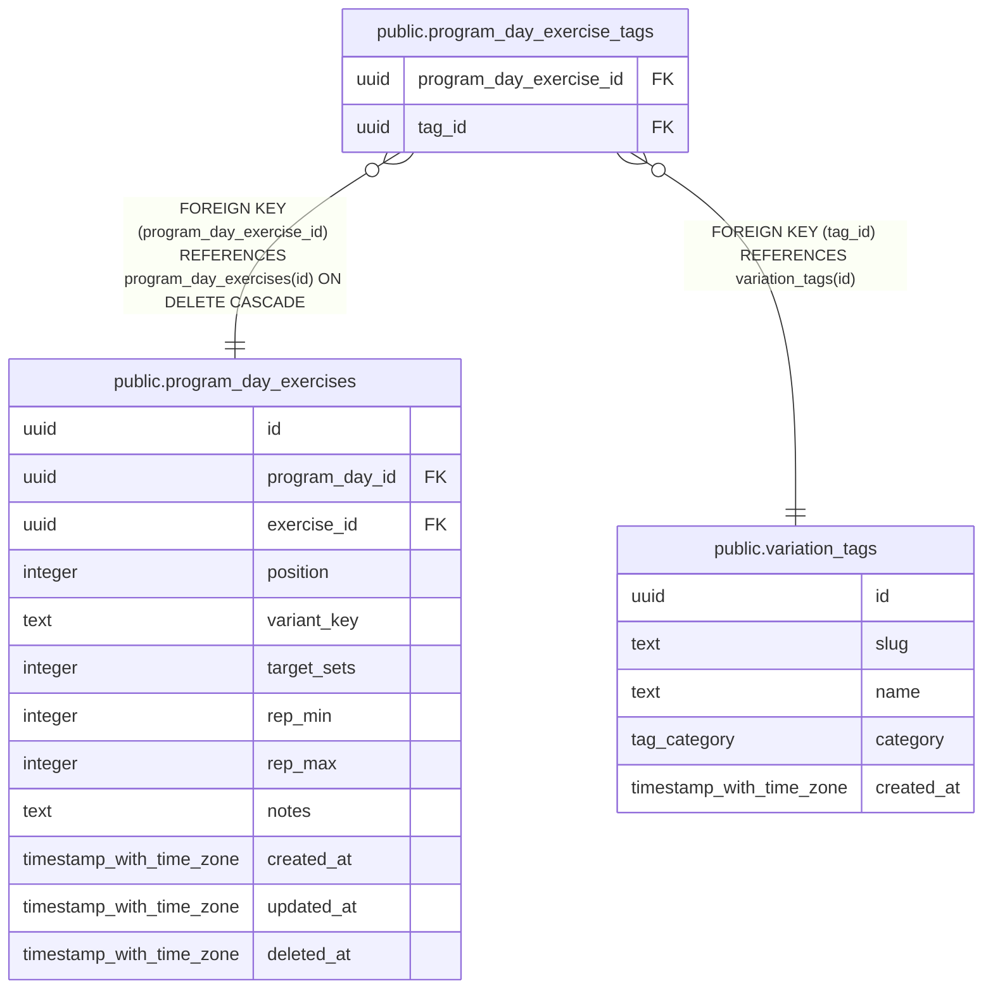

# public.program_day_exercise_tags

## Columns

| Name | Type | Default | Nullable | Children | Parents | Comment |
| ---- | ---- | ------- | -------- | -------- | ------- | ------- |
| program_day_exercise_id | uuid |  | false |  | [public.program_day_exercises](public.program_day_exercises.md) |  |
| tag_id | uuid |  | false |  | [public.variation_tags](public.variation_tags.md) |  |

## Viewpoints

| Name | Definition |
| ---- | ---------- |
| [Programs](viewpoint-3.md) | Splits, their days and target exercises, and enrollments. |

## Constraints

| Name | Type | Definition |
| ---- | ---- | ---------- |
| program_day_exercise_tags_program_day_exercise_id_not_null | n | NOT NULL program_day_exercise_id |
| program_day_exercise_tags_tag_id_not_null | n | NOT NULL tag_id |
| program_day_exercise_tags_tag_id_fkey | FOREIGN KEY | FOREIGN KEY (tag_id) REFERENCES variation_tags(id) |
| program_day_exercise_tags_program_day_exercise_id_fkey | FOREIGN KEY | FOREIGN KEY (program_day_exercise_id) REFERENCES program_day_exercises(id) ON DELETE CASCADE |
| program_day_exercise_tags_pkey | PRIMARY KEY | PRIMARY KEY (program_day_exercise_id, tag_id) |

## Indexes

| Name | Definition |
| ---- | ---------- |
| program_day_exercise_tags_pkey | CREATE UNIQUE INDEX program_day_exercise_tags_pkey ON public.program_day_exercise_tags USING btree (program_day_exercise_id, tag_id) |
| program_day_exercise_tags_tag_idx | CREATE INDEX program_day_exercise_tags_tag_idx ON public.program_day_exercise_tags USING btree (tag_id) |

## Triggers

| Name | Definition |
| ---- | ---------- |
| program_day_exercise_tags_variant_key | CREATE TRIGGER program_day_exercise_tags_variant_key AFTER INSERT OR DELETE ON public.program_day_exercise_tags FOR EACH ROW EXECUTE FUNCTION refresh_program_day_exercise_variant_key() |

## Relations

---

> Generated by [tbls](https://github.com/k1LoW/tbls)
