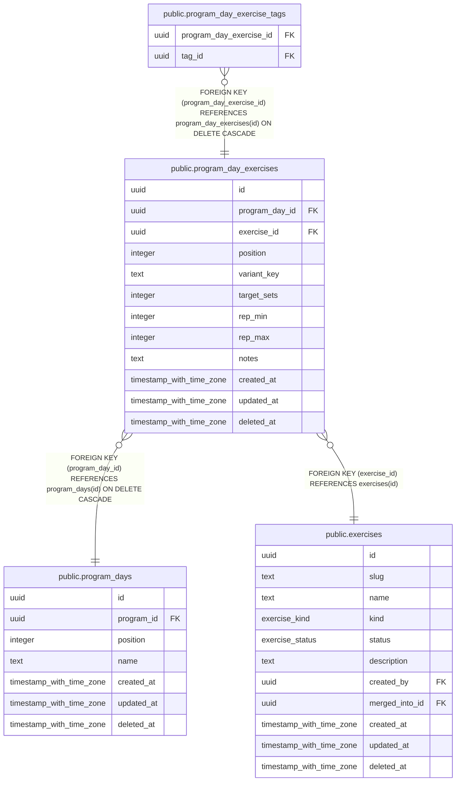

# public.program_day_exercises

## Columns

| Name | Type | Default | Nullable | Children | Parents | Comment |
| ---- | ---- | ------- | -------- | -------- | ------- | ------- |
| id | uuid | uuidv7() | false | [public.program_day_exercise_tags](public.program_day_exercise_tags.md) |  |  |
| program_day_id | uuid |  | false |  | [public.program_days](public.program_days.md) |  |
| exercise_id | uuid |  | false |  | [public.exercises](public.exercises.md) |  |
| position | integer |  | false |  |  |  |
| variant_key | text | ''::text | false |  |  | Maintained by trigger from program_day_exercise_tags. See workout_exercises.variant_key. |
| target_sets | integer |  | true |  |  |  |
| rep_min | integer |  | true |  |  |  |
| rep_max | integer |  | true |  |  |  |
| notes | text |  | true |  |  |  |
| created_at | timestamp with time zone | now() | false |  |  |  |
| updated_at | timestamp with time zone | now() | false |  |  |  |
| deleted_at | timestamp with time zone |  | true |  |  |  |

## Viewpoints

| Name | Definition |
| ---- | ---------- |
| [Programs](viewpoint-3.md) | Splits, their days and target exercises, and enrollments. |

## Constraints

| Name | Type | Definition |
| ---- | ---- | ---------- |
| program_day_exercises_check | CHECK | CHECK (((rep_min IS NULL) OR (rep_max IS NULL) OR (rep_min <= rep_max))) |
| program_day_exercises_created_at_not_null | n | NOT NULL created_at |
| program_day_exercises_exercise_id_not_null | n | NOT NULL exercise_id |
| program_day_exercises_id_not_null | n | NOT NULL id |
| program_day_exercises_position_not_null | n | NOT NULL "position" |
| program_day_exercises_program_day_id_not_null | n | NOT NULL program_day_id |
| program_day_exercises_rep_max_check | CHECK | CHECK ((rep_max > 0)) |
| program_day_exercises_rep_min_check | CHECK | CHECK ((rep_min > 0)) |
| program_day_exercises_target_sets_check | CHECK | CHECK ((target_sets > 0)) |
| program_day_exercises_updated_at_not_null | n | NOT NULL updated_at |
| program_day_exercises_variant_key_not_null | n | NOT NULL variant_key |
| program_day_exercises_exercise_id_fkey | FOREIGN KEY | FOREIGN KEY (exercise_id) REFERENCES exercises(id) |
| program_day_exercises_program_day_id_fkey | FOREIGN KEY | FOREIGN KEY (program_day_id) REFERENCES program_days(id) ON DELETE CASCADE |
| program_day_exercises_pkey | PRIMARY KEY | PRIMARY KEY (id) |

## Indexes

| Name | Definition |
| ---- | ---------- |
| program_day_exercises_pkey | CREATE UNIQUE INDEX program_day_exercises_pkey ON public.program_day_exercises USING btree (id) |
| program_day_exercises_day_idx | CREATE INDEX program_day_exercises_day_idx ON public.program_day_exercises USING btree (program_day_id, "position") WHERE (deleted_at IS NULL) |
| program_day_exercises_exercise_idx | CREATE INDEX program_day_exercises_exercise_idx ON public.program_day_exercises USING btree (exercise_id) |

## Triggers

| Name | Definition |
| ---- | ---------- |
| program_day_exercises_set_updated_at | CREATE TRIGGER program_day_exercises_set_updated_at BEFORE UPDATE ON public.program_day_exercises FOR EACH ROW EXECUTE FUNCTION set_updated_at() |

## Relations

---

> Generated by [tbls](https://github.com/k1LoW/tbls)
