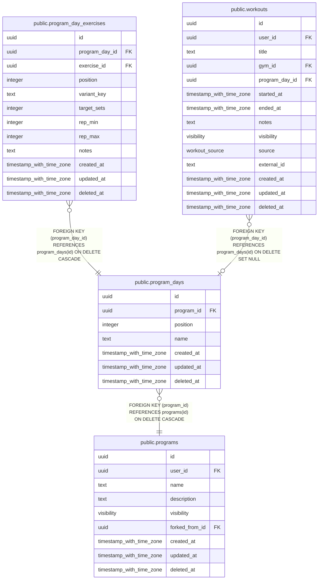

# public.program_days

## Columns

| Name | Type | Default | Nullable | Children | Parents | Comment |
| ---- | ---- | ------- | -------- | -------- | ------- | ------- |
| id | uuid | uuidv7() | false | [public.program_day_exercises](public.program_day_exercises.md) [public.workouts](public.workouts.md) |  |  |
| program_id | uuid |  | false |  | [public.programs](public.programs.md) |  |
| position | integer |  | false |  |  | Order within the program. Not unique-constrained, so reordering never needs deferred checks. |
| name | text |  | false |  |  |  |
| created_at | timestamp with time zone | now() | false |  |  |  |
| updated_at | timestamp with time zone | now() | false |  |  |  |
| deleted_at | timestamp with time zone |  | true |  |  |  |

## Viewpoints

| Name | Definition |
| ---- | ---------- |
| [Programs](viewpoint-3.md) | Splits, their days and target exercises, and enrollments. |

## Constraints

| Name | Type | Definition |
| ---- | ---- | ---------- |
| program_days_created_at_not_null | n | NOT NULL created_at |
| program_days_id_not_null | n | NOT NULL id |
| program_days_name_not_null | n | NOT NULL name |
| program_days_position_not_null | n | NOT NULL "position" |
| program_days_program_id_not_null | n | NOT NULL program_id |
| program_days_updated_at_not_null | n | NOT NULL updated_at |
| program_days_program_id_fkey | FOREIGN KEY | FOREIGN KEY (program_id) REFERENCES programs(id) ON DELETE CASCADE |
| program_days_pkey | PRIMARY KEY | PRIMARY KEY (id) |

## Indexes

| Name | Definition |
| ---- | ---------- |
| program_days_pkey | CREATE UNIQUE INDEX program_days_pkey ON public.program_days USING btree (id) |
| program_days_program_idx | CREATE INDEX program_days_program_idx ON public.program_days USING btree (program_id, "position") WHERE (deleted_at IS NULL) |

## Triggers

| Name | Definition |
| ---- | ---------- |
| program_days_set_updated_at | CREATE TRIGGER program_days_set_updated_at BEFORE UPDATE ON public.program_days FOR EACH ROW EXECUTE FUNCTION set_updated_at() |

## Relations

---

> Generated by [tbls](https://github.com/k1LoW/tbls)
