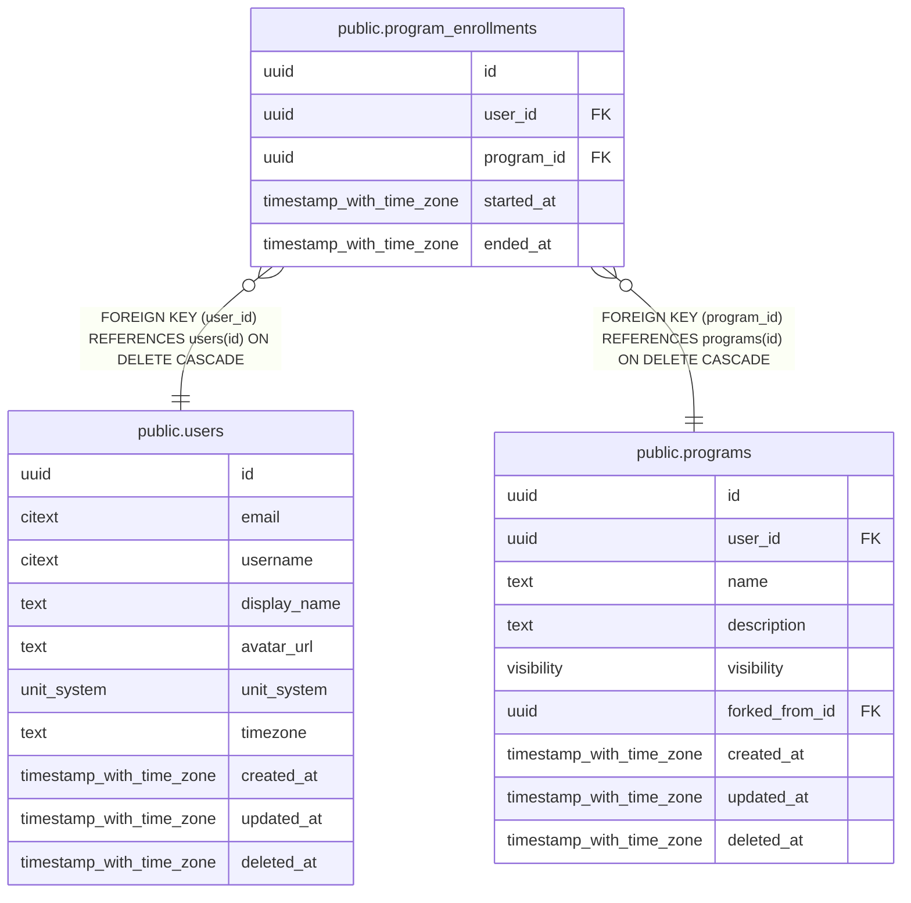

# public.program_enrollments

## Description

Which program a user is currently following. At most one active row per user.

## Columns

| Name | Type | Default | Nullable | Children | Parents | Comment |
| ---- | ---- | ------- | -------- | -------- | ------- | ------- |
| id | uuid | uuidv7() | false |  |  |  |
| user_id | uuid |  | false |  | [public.users](public.users.md) |  |
| program_id | uuid |  | false |  | [public.programs](public.programs.md) |  |
| started_at | timestamp with time zone | now() | false |  |  |  |
| ended_at | timestamp with time zone |  | true |  |  |  |

## Viewpoints

| Name | Definition |
| ---- | ---------- |
| [Programs](viewpoint-3.md) | Splits, their days and target exercises, and enrollments. |

## Constraints

| Name | Type | Definition |
| ---- | ---- | ---------- |
| program_enrollments_check | CHECK | CHECK (((ended_at IS NULL) OR (ended_at >= started_at))) |
| program_enrollments_id_not_null | n | NOT NULL id |
| program_enrollments_program_id_not_null | n | NOT NULL program_id |
| program_enrollments_started_at_not_null | n | NOT NULL started_at |
| program_enrollments_user_id_not_null | n | NOT NULL user_id |
| program_enrollments_user_id_fkey | FOREIGN KEY | FOREIGN KEY (user_id) REFERENCES users(id) ON DELETE CASCADE |
| program_enrollments_program_id_fkey | FOREIGN KEY | FOREIGN KEY (program_id) REFERENCES programs(id) ON DELETE CASCADE |
| program_enrollments_pkey | PRIMARY KEY | PRIMARY KEY (id) |

## Indexes

| Name | Definition |
| ---- | ---------- |
| program_enrollments_pkey | CREATE UNIQUE INDEX program_enrollments_pkey ON public.program_enrollments USING btree (id) |
| program_enrollments_program_idx | CREATE INDEX program_enrollments_program_idx ON public.program_enrollments USING btree (program_id) |
| program_enrollments_one_active_idx | CREATE UNIQUE INDEX program_enrollments_one_active_idx ON public.program_enrollments USING btree (user_id) WHERE (ended_at IS NULL) |

## Relations

---

> Generated by [tbls](https://github.com/k1LoW/tbls)
