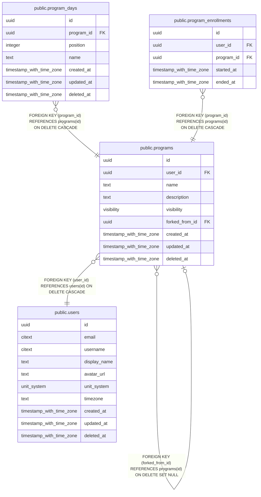

# public.programs

## Description

A split, e.g. "Push / Pull / Legs". forked_from_id supports copying a friend's program later.

## Columns

| Name | Type | Default | Nullable | Children | Parents | Comment |
| ---- | ---- | ------- | -------- | -------- | ------- | ------- |
| id | uuid | uuidv7() | false | [public.programs](public.programs.md) [public.program_days](public.program_days.md) [public.program_enrollments](public.program_enrollments.md) |  |  |
| user_id | uuid |  | false |  | [public.users](public.users.md) |  |
| name | text |  | false |  |  |  |
| description | text |  | true |  |  |  |
| visibility | visibility | 'private'::visibility | false |  |  |  |
| forked_from_id | uuid |  | true |  | [public.programs](public.programs.md) |  |
| created_at | timestamp with time zone | now() | false |  |  |  |
| updated_at | timestamp with time zone | now() | false |  |  |  |
| deleted_at | timestamp with time zone |  | true |  |  |  |

## Viewpoints

| Name | Definition |
| ---- | ---------- |
| [Programs](viewpoint-3.md) | Splits, their days and target exercises, and enrollments. |

## Constraints

| Name | Type | Definition |
| ---- | ---- | ---------- |
| programs_created_at_not_null | n | NOT NULL created_at |
| programs_id_not_null | n | NOT NULL id |
| programs_name_not_null | n | NOT NULL name |
| programs_updated_at_not_null | n | NOT NULL updated_at |
| programs_user_id_not_null | n | NOT NULL user_id |
| programs_visibility_not_null | n | NOT NULL visibility |
| programs_user_id_fkey | FOREIGN KEY | FOREIGN KEY (user_id) REFERENCES users(id) ON DELETE CASCADE |
| programs_forked_from_id_fkey | FOREIGN KEY | FOREIGN KEY (forked_from_id) REFERENCES programs(id) ON DELETE SET NULL |
| programs_pkey | PRIMARY KEY | PRIMARY KEY (id) |

## Indexes

| Name | Definition |
| ---- | ---------- |
| programs_pkey | CREATE UNIQUE INDEX programs_pkey ON public.programs USING btree (id) |
| programs_user_idx | CREATE INDEX programs_user_idx ON public.programs USING btree (user_id) WHERE (deleted_at IS NULL) |

## Triggers

| Name | Definition |
| ---- | ---------- |
| programs_set_updated_at | CREATE TRIGGER programs_set_updated_at BEFORE UPDATE ON public.programs FOR EACH ROW EXECUTE FUNCTION set_updated_at() |

## Relations

---

> Generated by [tbls](https://github.com/k1LoW/tbls)
