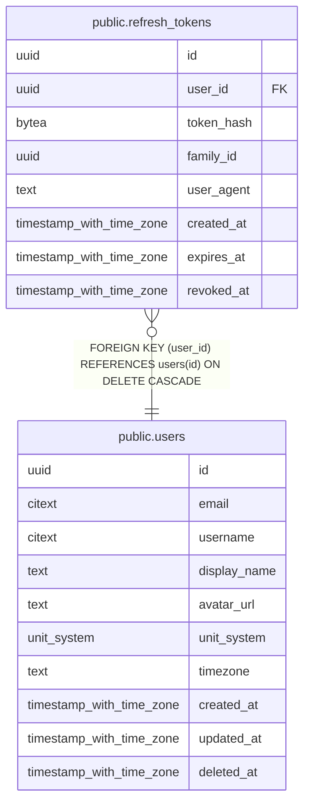

# public.refresh_tokens

## Description

Our own session tokens, issued after OAuth verification. Only a hash is stored.

## Columns

| Name | Type | Default | Nullable | Children | Parents | Comment |
| ---- | ---- | ------- | -------- | -------- | ------- | ------- |
| id | uuid | uuidv7() | false |  |  |  |
| user_id | uuid |  | false |  | [public.users](public.users.md) |  |
| token_hash | bytea |  | false |  |  |  |
| family_id | uuid |  | false |  |  | Shared by all tokens descended from one login. Reuse of a revoked token revokes the whole family. |
| user_agent | text |  | true |  |  |  |
| created_at | timestamp with time zone | now() | false |  |  |  |
| expires_at | timestamp with time zone |  | false |  |  |  |
| revoked_at | timestamp with time zone |  | true |  |  |  |

## Viewpoints

| Name | Definition |
| ---- | ---------- |
| [Auth](viewpoint-0.md) | Accounts, linked OAuth identities and sessions. |

## Constraints

| Name | Type | Definition |
| ---- | ---- | ---------- |
| refresh_tokens_created_at_not_null | n | NOT NULL created_at |
| refresh_tokens_expires_at_not_null | n | NOT NULL expires_at |
| refresh_tokens_family_id_not_null | n | NOT NULL family_id |
| refresh_tokens_id_not_null | n | NOT NULL id |
| refresh_tokens_token_hash_not_null | n | NOT NULL token_hash |
| refresh_tokens_user_id_not_null | n | NOT NULL user_id |
| refresh_tokens_user_id_fkey | FOREIGN KEY | FOREIGN KEY (user_id) REFERENCES users(id) ON DELETE CASCADE |
| refresh_tokens_pkey | PRIMARY KEY | PRIMARY KEY (id) |
| refresh_tokens_token_hash_key | UNIQUE | UNIQUE (token_hash) |

## Indexes

| Name | Definition |
| ---- | ---------- |
| refresh_tokens_pkey | CREATE UNIQUE INDEX refresh_tokens_pkey ON public.refresh_tokens USING btree (id) |
| refresh_tokens_token_hash_key | CREATE UNIQUE INDEX refresh_tokens_token_hash_key ON public.refresh_tokens USING btree (token_hash) |
| refresh_tokens_user_id_idx | CREATE INDEX refresh_tokens_user_id_idx ON public.refresh_tokens USING btree (user_id) |
| refresh_tokens_family_id_idx | CREATE INDEX refresh_tokens_family_id_idx ON public.refresh_tokens USING btree (family_id) |

## Relations

---

> Generated by [tbls](https://github.com/k1LoW/tbls)
