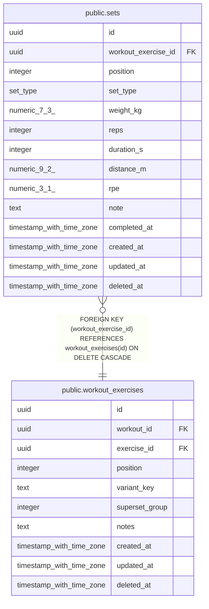

# public.sets

## Description

Individual sets. Which of weight/reps/duration/distance are required depends on exercises.kind; enforced in the API.

## Columns

| Name | Type | Default | Nullable | Children | Parents | Comment |
| ---- | ---- | ------- | -------- | -------- | ------- | ------- |
| id | uuid | uuidv7() | false |  |  |  |
| workout_exercise_id | uuid |  | false |  | [public.workout_exercises](public.workout_exercises.md) |  |
| position | integer |  | false |  |  |  |
| set_type | set_type | 'working'::set_type | false |  |  |  |
| weight_kg | numeric(7,3) |  | true |  |  |  |
| reps | integer |  | true |  |  |  |
| duration_s | integer |  | true |  |  |  |
| distance_m | numeric(9,2) |  | true |  |  |  |
| rpe | numeric(3,1) |  | true |  |  |  |
| note | text |  | true |  |  |  |
| completed_at | timestamp with time zone |  | true |  |  |  |
| created_at | timestamp with time zone | now() | false |  |  |  |
| updated_at | timestamp with time zone | now() | false |  |  |  |
| deleted_at | timestamp with time zone |  | true |  |  |  |

## Viewpoints

| Name | Definition |
| ---- | ---------- |
| [Workout logging](viewpoint-2.md) | Workouts, their exercises (with stacked tags), sets and gyms. |

## Constraints

| Name | Type | Definition |
| ---- | ---- | ---------- |
| sets_created_at_not_null | n | NOT NULL created_at |
| sets_distance_m_check | CHECK | CHECK ((distance_m >= (0)::numeric)) |
| sets_duration_s_check | CHECK | CHECK ((duration_s >= 0)) |
| sets_id_not_null | n | NOT NULL id |
| sets_position_not_null | n | NOT NULL "position" |
| sets_reps_check | CHECK | CHECK ((reps >= 0)) |
| sets_rpe_check | CHECK | CHECK (((rpe >= (1)::numeric) AND (rpe <= (10)::numeric))) |
| sets_set_type_not_null | n | NOT NULL set_type |
| sets_updated_at_not_null | n | NOT NULL updated_at |
| sets_weight_kg_check | CHECK | CHECK ((weight_kg >= (0)::numeric)) |
| sets_workout_exercise_id_not_null | n | NOT NULL workout_exercise_id |
| sets_workout_exercise_id_fkey | FOREIGN KEY | FOREIGN KEY (workout_exercise_id) REFERENCES workout_exercises(id) ON DELETE CASCADE |
| sets_pkey | PRIMARY KEY | PRIMARY KEY (id) |

## Indexes

| Name | Definition |
| ---- | ---------- |
| sets_pkey | CREATE UNIQUE INDEX sets_pkey ON public.sets USING btree (id) |
| sets_workout_exercise_idx | CREATE INDEX sets_workout_exercise_idx ON public.sets USING btree (workout_exercise_id, "position") WHERE (deleted_at IS NULL) |

## Triggers

| Name | Definition |
| ---- | ---------- |
| sets_set_updated_at | CREATE TRIGGER sets_set_updated_at BEFORE UPDATE ON public.sets FOR EACH ROW EXECUTE FUNCTION set_updated_at() |

## Relations

---

> Generated by [tbls](https://github.com/k1LoW/tbls)
