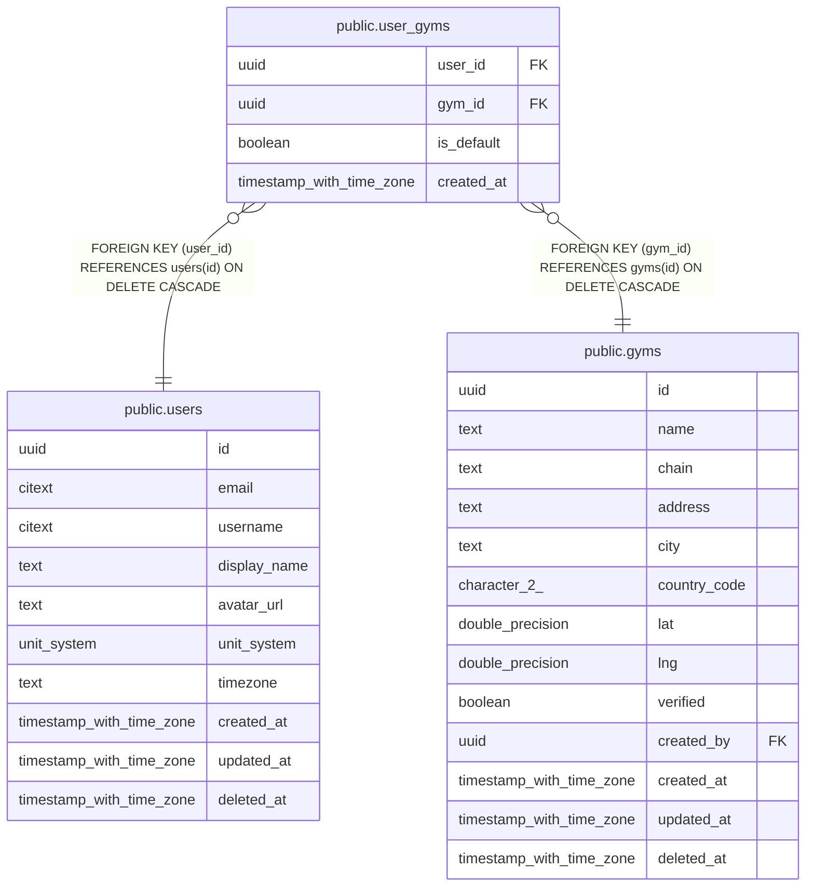

# public.user_gyms

## Description

A user's saved gyms. Doubles as gym membership for later social features.

## Columns

| Name | Type | Default | Nullable | Children | Parents | Comment |
| ---- | ---- | ------- | -------- | -------- | ------- | ------- |
| user_id | uuid |  | false |  | [public.users](public.users.md) |  |
| gym_id | uuid |  | false |  | [public.gyms](public.gyms.md) |  |
| is_default | boolean | false | false |  |  |  |
| created_at | timestamp with time zone | now() | false |  |  |  |

## Viewpoints

| Name | Definition |
| ---- | ---------- |
| [Gyms](viewpoint-4.md) | Gym directory and users' saved gyms. |

## Constraints

| Name | Type | Definition |
| ---- | ---- | ---------- |
| user_gyms_created_at_not_null | n | NOT NULL created_at |
| user_gyms_gym_id_not_null | n | NOT NULL gym_id |
| user_gyms_is_default_not_null | n | NOT NULL is_default |
| user_gyms_user_id_not_null | n | NOT NULL user_id |
| user_gyms_user_id_fkey | FOREIGN KEY | FOREIGN KEY (user_id) REFERENCES users(id) ON DELETE CASCADE |
| user_gyms_gym_id_fkey | FOREIGN KEY | FOREIGN KEY (gym_id) REFERENCES gyms(id) ON DELETE CASCADE |
| user_gyms_pkey | PRIMARY KEY | PRIMARY KEY (user_id, gym_id) |

## Indexes

| Name | Definition |
| ---- | ---------- |
| user_gyms_pkey | CREATE UNIQUE INDEX user_gyms_pkey ON public.user_gyms USING btree (user_id, gym_id) |
| user_gyms_gym_idx | CREATE INDEX user_gyms_gym_idx ON public.user_gyms USING btree (gym_id) |
| user_gyms_one_default_idx | CREATE UNIQUE INDEX user_gyms_one_default_idx ON public.user_gyms USING btree (user_id) WHERE is_default |

## Relations

---

> Generated by [tbls](https://github.com/k1LoW/tbls)
