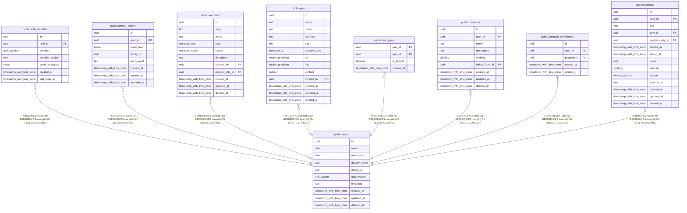

# public.users

## Description

Application accounts. Identity proof lives in auth_identities, not here.

## Columns

| Name | Type | Default | Nullable | Children | Parents | Comment |
| ---- | ---- | ------- | -------- | -------- | ------- | ------- |
| id | uuid | uuidv7() | false | [public.auth_identities](public.auth_identities.md) [public.refresh_tokens](public.refresh_tokens.md) [public.exercises](public.exercises.md) [public.gyms](public.gyms.md) [public.user_gyms](public.user_gyms.md) [public.programs](public.programs.md) [public.program_enrollments](public.program_enrollments.md) [public.workouts](public.workouts.md) |  |  |
| email | citext |  | false |  |  |  |
| username | citext |  | false |  |  |  |
| display_name | text |  | false |  |  |  |
| avatar_url | text |  | true |  |  |  |
| unit_system | unit_system | 'metric'::unit_system | false |  |  | Display preference only. All weights/distances are stored in metric. |
| timezone | text | 'UTC'::text | false |  |  | IANA name. Used to bucket workouts into local days for streaks and the heatmap. |
| created_at | timestamp with time zone | now() | false |  |  |  |
| updated_at | timestamp with time zone | now() | false |  |  |  |
| deleted_at | timestamp with time zone |  | true |  |  |  |

## Viewpoints

| Name | Definition |
| ---- | ---------- |
| [Auth](viewpoint-0.md) | Accounts, linked OAuth identities and sessions. |
| [Workout logging](viewpoint-2.md) | Workouts, their exercises (with stacked tags), sets and gyms. |
| [Programs](viewpoint-3.md) | Splits, their days and target exercises, and enrollments. |
| [Gyms](viewpoint-4.md) | Gym directory and users' saved gyms. |

## Constraints

| Name | Type | Definition |
| ---- | ---- | ---------- |
| users_created_at_not_null | n | NOT NULL created_at |
| users_display_name_not_null | n | NOT NULL display_name |
| users_email_not_null | n | NOT NULL email |
| users_id_not_null | n | NOT NULL id |
| users_timezone_not_null | n | NOT NULL timezone |
| users_unit_system_not_null | n | NOT NULL unit_system |
| users_updated_at_not_null | n | NOT NULL updated_at |
| users_username_check | CHECK | CHECK ((username ~ '^[a-z0-9_]{3,30}$'::citext)) |
| users_username_not_null | n | NOT NULL username |
| users_pkey | PRIMARY KEY | PRIMARY KEY (id) |
| users_email_key | UNIQUE | UNIQUE (email) |
| users_username_key | UNIQUE | UNIQUE (username) |

## Indexes

| Name | Definition |
| ---- | ---------- |
| users_pkey | CREATE UNIQUE INDEX users_pkey ON public.users USING btree (id) |
| users_email_key | CREATE UNIQUE INDEX users_email_key ON public.users USING btree (email) |
| users_username_key | CREATE UNIQUE INDEX users_username_key ON public.users USING btree (username) |

## Triggers

| Name | Definition |
| ---- | ---------- |
| users_set_updated_at | CREATE TRIGGER users_set_updated_at BEFORE UPDATE ON public.users FOR EACH ROW EXECUTE FUNCTION set_updated_at() |

## Relations

---

> Generated by [tbls](https://github.com/k1LoW/tbls)
