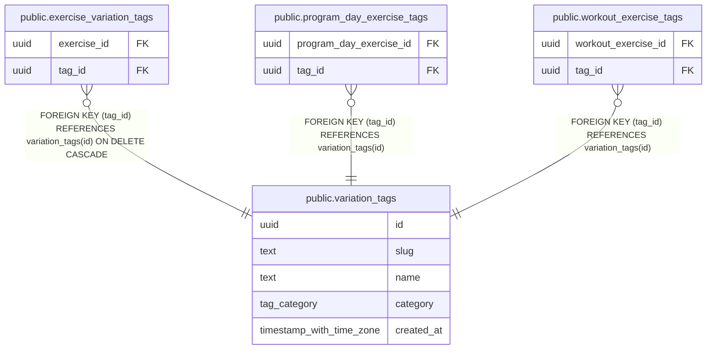

# public.variation_tags

## Description

Stackable modifiers (cable, v-bar, neutral grip). Slugs are immutable: they feed variant_key.

## Columns

| Name | Type | Default | Nullable | Children | Parents | Comment |
| ---- | ---- | ------- | -------- | -------- | ------- | ------- |
| id | uuid | uuidv7() | false | [public.exercise_variation_tags](public.exercise_variation_tags.md) [public.program_day_exercise_tags](public.program_day_exercise_tags.md) [public.workout_exercise_tags](public.workout_exercise_tags.md) |  |  |
| slug | text |  | false |  |  |  |
| name | text |  | false |  |  |  |
| category | tag_category | 'other'::tag_category | false |  |  |  |
| created_at | timestamp with time zone | now() | false |  |  |  |

## Viewpoints

| Name | Definition |
| ---- | ---------- |
| [Exercise catalog](viewpoint-1.md) | Canonical exercises, muscles, aliases and stackable variation tags. |
| [Workout logging](viewpoint-2.md) | Workouts, their exercises (with stacked tags), sets and gyms. |
| [Programs](viewpoint-3.md) | Splits, their days and target exercises, and enrollments. |

## Constraints

| Name | Type | Definition |
| ---- | ---- | ---------- |
| variation_tags_category_not_null | n | NOT NULL category |
| variation_tags_created_at_not_null | n | NOT NULL created_at |
| variation_tags_id_not_null | n | NOT NULL id |
| variation_tags_name_not_null | n | NOT NULL name |
| variation_tags_slug_not_null | n | NOT NULL slug |
| variation_tags_pkey | PRIMARY KEY | PRIMARY KEY (id) |
| variation_tags_slug_key | UNIQUE | UNIQUE (slug) |

## Indexes

| Name | Definition |
| ---- | ---------- |
| variation_tags_pkey | CREATE UNIQUE INDEX variation_tags_pkey ON public.variation_tags USING btree (id) |
| variation_tags_slug_key | CREATE UNIQUE INDEX variation_tags_slug_key ON public.variation_tags USING btree (slug) |

## Relations

---

> Generated by [tbls](https://github.com/k1LoW/tbls)
