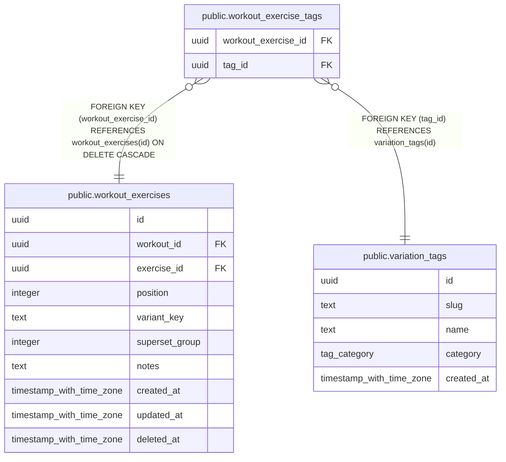

# public.workout_exercise_tags

## Columns

| Name | Type | Default | Nullable | Children | Parents | Comment |
| ---- | ---- | ------- | -------- | -------- | ------- | ------- |
| workout_exercise_id | uuid |  | false |  | [public.workout_exercises](public.workout_exercises.md) |  |
| tag_id | uuid |  | false |  | [public.variation_tags](public.variation_tags.md) |  |

## Viewpoints

| Name | Definition |
| ---- | ---------- |
| [Workout logging](viewpoint-2.md) | Workouts, their exercises (with stacked tags), sets and gyms. |

## Constraints

| Name | Type | Definition |
| ---- | ---- | ---------- |
| workout_exercise_tags_tag_id_not_null | n | NOT NULL tag_id |
| workout_exercise_tags_workout_exercise_id_not_null | n | NOT NULL workout_exercise_id |
| workout_exercise_tags_tag_id_fkey | FOREIGN KEY | FOREIGN KEY (tag_id) REFERENCES variation_tags(id) |
| workout_exercise_tags_workout_exercise_id_fkey | FOREIGN KEY | FOREIGN KEY (workout_exercise_id) REFERENCES workout_exercises(id) ON DELETE CASCADE |
| workout_exercise_tags_pkey | PRIMARY KEY | PRIMARY KEY (workout_exercise_id, tag_id) |

## Indexes

| Name | Definition |
| ---- | ---------- |
| workout_exercise_tags_pkey | CREATE UNIQUE INDEX workout_exercise_tags_pkey ON public.workout_exercise_tags USING btree (workout_exercise_id, tag_id) |
| workout_exercise_tags_tag_idx | CREATE INDEX workout_exercise_tags_tag_idx ON public.workout_exercise_tags USING btree (tag_id) |

## Triggers

| Name | Definition |
| ---- | ---------- |
| workout_exercise_tags_variant_key | CREATE TRIGGER workout_exercise_tags_variant_key AFTER INSERT OR DELETE ON public.workout_exercise_tags FOR EACH ROW EXECUTE FUNCTION refresh_workout_exercise_variant_key() |

## Relations

---

> Generated by [tbls](https://github.com/k1LoW/tbls)
