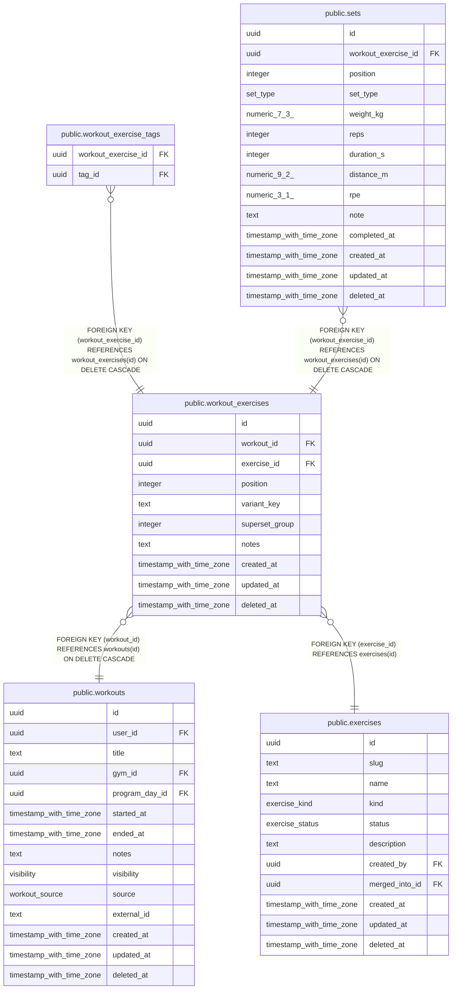

# public.workout_exercises

## Columns

| Name | Type | Default | Nullable | Children | Parents | Comment |
| ---- | ---- | ------- | -------- | -------- | ------- | ------- |
| id | uuid | uuidv7() | false | [public.workout_exercise_tags](public.workout_exercise_tags.md) [public.sets](public.sets.md) |  |  |
| workout_id | uuid |  | false |  | [public.workouts](public.workouts.md) |  |
| exercise_id | uuid |  | false |  | [public.exercises](public.exercises.md) |  |
| position | integer |  | false |  |  |  |
| variant_key | text | ''::text | false |  |  | Sorted tag slugs joined by "+", e.g. "cable+v-bar"; empty when untagged. Maintained by trigger from workout_exercise_tags. Group by (exercise_id, variant_key) for progress and leaderboards. |
| superset_group | integer |  | true |  |  | Exercises in one workout sharing the same number are a superset. |
| notes | text |  | true |  |  |  |
| created_at | timestamp with time zone | now() | false |  |  |  |
| updated_at | timestamp with time zone | now() | false |  |  |  |
| deleted_at | timestamp with time zone |  | true |  |  |  |

## Viewpoints

| Name | Definition |
| ---- | ---------- |
| [Workout logging](viewpoint-2.md) | Workouts, their exercises (with stacked tags), sets and gyms. |

## Constraints

| Name | Type | Definition |
| ---- | ---- | ---------- |
| workout_exercises_created_at_not_null | n | NOT NULL created_at |
| workout_exercises_exercise_id_not_null | n | NOT NULL exercise_id |
| workout_exercises_id_not_null | n | NOT NULL id |
| workout_exercises_position_not_null | n | NOT NULL "position" |
| workout_exercises_updated_at_not_null | n | NOT NULL updated_at |
| workout_exercises_variant_key_not_null | n | NOT NULL variant_key |
| workout_exercises_workout_id_not_null | n | NOT NULL workout_id |
| workout_exercises_exercise_id_fkey | FOREIGN KEY | FOREIGN KEY (exercise_id) REFERENCES exercises(id) |
| workout_exercises_workout_id_fkey | FOREIGN KEY | FOREIGN KEY (workout_id) REFERENCES workouts(id) ON DELETE CASCADE |
| workout_exercises_pkey | PRIMARY KEY | PRIMARY KEY (id) |

## Indexes

| Name | Definition |
| ---- | ---------- |
| workout_exercises_pkey | CREATE UNIQUE INDEX workout_exercises_pkey ON public.workout_exercises USING btree (id) |
| workout_exercises_workout_idx | CREATE INDEX workout_exercises_workout_idx ON public.workout_exercises USING btree (workout_id, "position") WHERE (deleted_at IS NULL) |
| workout_exercises_progress_idx | CREATE INDEX workout_exercises_progress_idx ON public.workout_exercises USING btree (exercise_id, variant_key) WHERE (deleted_at IS NULL) |

## Triggers

| Name | Definition |
| ---- | ---------- |
| workout_exercises_set_updated_at | CREATE TRIGGER workout_exercises_set_updated_at BEFORE UPDATE ON public.workout_exercises FOR EACH ROW EXECUTE FUNCTION set_updated_at() |

## Relations

---

> Generated by [tbls](https://github.com/k1LoW/tbls)
