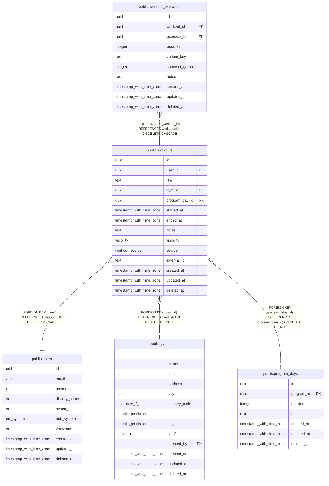

# public.workouts

## Description

One training session. Day bucketing (heatmap, streaks) uses started_at in users.timezone.

## Columns

| Name | Type | Default | Nullable | Children | Parents | Comment |
| ---- | ---- | ------- | -------- | -------- | ------- | ------- |
| id | uuid | uuidv7() | false | [public.workout_exercises](public.workout_exercises.md) |  |  |
| user_id | uuid |  | false |  | [public.users](public.users.md) |  |
| title | text |  | true |  |  |  |
| gym_id | uuid |  | true |  | [public.gyms](public.gyms.md) |  |
| program_day_id | uuid |  | true |  | [public.program_days](public.program_days.md) |  |
| started_at | timestamp with time zone |  | false |  |  |  |
| ended_at | timestamp with time zone |  | true |  |  |  |
| notes | text |  | true |  |  |  |
| visibility | visibility | 'private'::visibility | false |  |  |  |
| source | workout_source | 'manual'::workout_source | false |  |  |  |
| external_id | text |  | true |  |  | Row key from an import source. With source it makes re-running an import idempotent. |
| created_at | timestamp with time zone | now() | false |  |  |  |
| updated_at | timestamp with time zone | now() | false |  |  |  |
| deleted_at | timestamp with time zone |  | true |  |  |  |

## Viewpoints

| Name | Definition |
| ---- | ---------- |
| [Workout logging](viewpoint-2.md) | Workouts, their exercises (with stacked tags), sets and gyms. |
| [Gyms](viewpoint-4.md) | Gym directory and users' saved gyms. |

## Constraints

| Name | Type | Definition |
| ---- | ---- | ---------- |
| workouts_check | CHECK | CHECK (((ended_at IS NULL) OR (ended_at >= started_at))) |
| workouts_check1 | CHECK | CHECK (((source = 'manual'::workout_source) = (external_id IS NULL))) |
| workouts_created_at_not_null | n | NOT NULL created_at |
| workouts_id_not_null | n | NOT NULL id |
| workouts_source_not_null | n | NOT NULL source |
| workouts_started_at_not_null | n | NOT NULL started_at |
| workouts_updated_at_not_null | n | NOT NULL updated_at |
| workouts_user_id_not_null | n | NOT NULL user_id |
| workouts_visibility_not_null | n | NOT NULL visibility |
| workouts_user_id_fkey | FOREIGN KEY | FOREIGN KEY (user_id) REFERENCES users(id) ON DELETE CASCADE |
| workouts_gym_id_fkey | FOREIGN KEY | FOREIGN KEY (gym_id) REFERENCES gyms(id) ON DELETE SET NULL |
| workouts_program_day_id_fkey | FOREIGN KEY | FOREIGN KEY (program_day_id) REFERENCES program_days(id) ON DELETE SET NULL |
| workouts_pkey | PRIMARY KEY | PRIMARY KEY (id) |

## Indexes

| Name | Definition |
| ---- | ---------- |
| workouts_pkey | CREATE UNIQUE INDEX workouts_pkey ON public.workouts USING btree (id) |
| workouts_user_started_idx | CREATE INDEX workouts_user_started_idx ON public.workouts USING btree (user_id, started_at DESC) WHERE (deleted_at IS NULL) |
| workouts_gym_idx | CREATE INDEX workouts_gym_idx ON public.workouts USING btree (gym_id) WHERE (gym_id IS NOT NULL) |
| workouts_program_day_idx | CREATE INDEX workouts_program_day_idx ON public.workouts USING btree (program_day_id) WHERE (program_day_id IS NOT NULL) |
| workouts_import_idempotency_idx | CREATE UNIQUE INDEX workouts_import_idempotency_idx ON public.workouts USING btree (user_id, source, external_id) WHERE (external_id IS NOT NULL) |

## Triggers

| Name | Definition |
| ---- | ---------- |
| workouts_set_updated_at | CREATE TRIGGER workouts_set_updated_at BEFORE UPDATE ON public.workouts FOR EACH ROW EXECUTE FUNCTION set_updated_at() |

## Relations

---

> Generated by [tbls](https://github.com/k1LoW/tbls)
