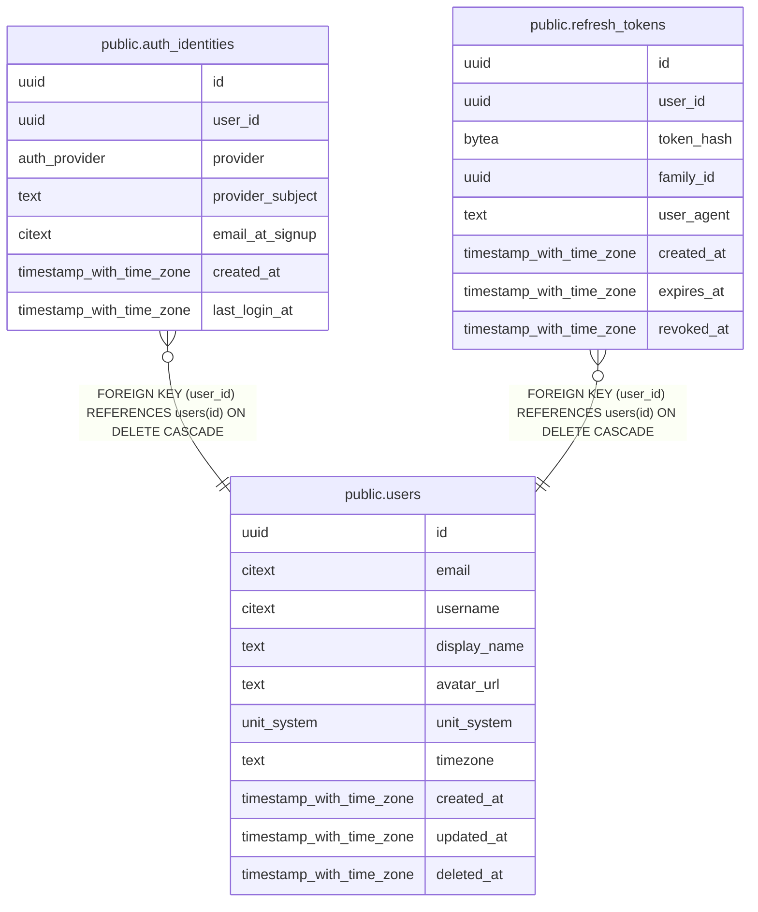

# Auth

## Description

Accounts, linked OAuth identities and sessions.

## Tables

| Name | Columns | Comment | Type |
| ---- | ------- | ------- | ---- |
| [public.users](public.users.md) | 10 | Application accounts. Identity proof lives in auth_identities, not here. | BASE TABLE |
| [public.auth_identities](public.auth_identities.md) | 7 | One row per linked OAuth account. A user may link several providers. | BASE TABLE |
| [public.refresh_tokens](public.refresh_tokens.md) | 8 | Our own session tokens, issued after OAuth verification. Only a hash is stored. | BASE TABLE |

## Relations

---

> Generated by [tbls](https://github.com/k1LoW/tbls)
