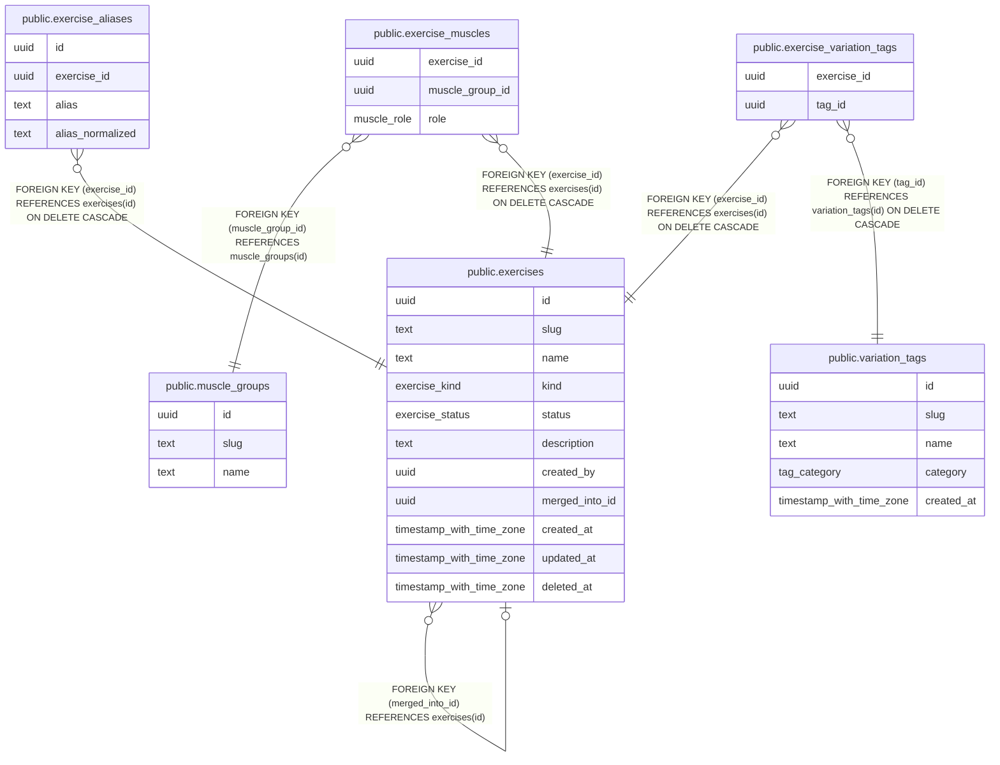

# Exercise catalog

## Description

Canonical exercises, muscles, aliases and stackable variation tags.

## Tables

| Name | Columns | Comment | Type |
| ---- | ------- | ------- | ---- |
| [public.muscle_groups](public.muscle_groups.md) | 3 | Reference list of muscle groups (chest, lats, quads, ...). | BASE TABLE |
| [public.exercises](public.exercises.md) | 11 | Canonical exercises, e.g. "Lat Pulldown". Variations are tags, not separate exercises. | BASE TABLE |
| [public.exercise_muscles](public.exercise_muscles.md) | 3 |  | BASE TABLE |
| [public.exercise_aliases](public.exercise_aliases.md) | 4 | Alternate names ("Lat Pulldowns") that resolve to a canonical exercise. Globally unique once normalised. | BASE TABLE |
| [public.variation_tags](public.variation_tags.md) | 5 | Stackable modifiers (cable, v-bar, neutral grip). Slugs are immutable: they feed variant_key. | BASE TABLE |
| [public.exercise_variation_tags](public.exercise_variation_tags.md) | 2 | Optional: tags suggested in the UI for an exercise. Not a restriction. | BASE TABLE |

## Relations

---

> Generated by [tbls](https://github.com/k1LoW/tbls)
