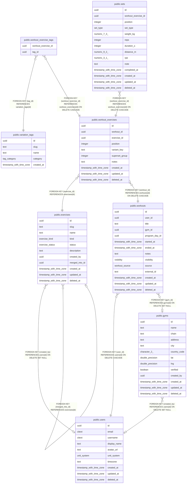

# Workout logging

## Description

Workouts, their exercises (with stacked tags), sets and gyms.

## Tables

| Name | Columns | Comment | Type |
| ---- | ------- | ------- | ---- |
| [public.users](public.users.md) | 10 | Application accounts. Identity proof lives in auth_identities, not here. | BASE TABLE |
| [public.exercises](public.exercises.md) | 11 | Canonical exercises, e.g. "Lat Pulldown". Variations are tags, not separate exercises. | BASE TABLE |
| [public.variation_tags](public.variation_tags.md) | 5 | Stackable modifiers (cable, v-bar, neutral grip). Slugs are immutable: they feed variant_key. | BASE TABLE |
| [public.gyms](public.gyms.md) | 13 | Shared gym directory, e.g. "Golds Gym, Aundh". Plain lat/lng for now; PostGIS only if "gyms near me" needs it. | BASE TABLE |
| [public.workouts](public.workouts.md) | 14 | One training session. Day bucketing (heatmap, streaks) uses started_at in users.timezone. | BASE TABLE |
| [public.workout_exercises](public.workout_exercises.md) | 10 |  | BASE TABLE |
| [public.workout_exercise_tags](public.workout_exercise_tags.md) | 2 |  | BASE TABLE |
| [public.sets](public.sets.md) | 14 | Individual sets. Which of weight/reps/duration/distance are required depends on exercises.kind; enforced in the API. | BASE TABLE |

## Relations

---

> Generated by [tbls](https://github.com/k1LoW/tbls)
