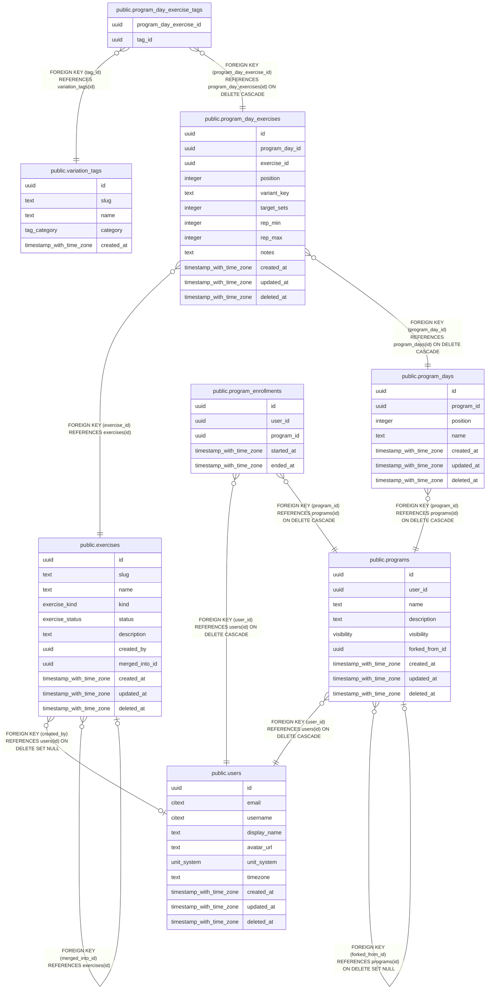

# Programs

## Description

Splits, their days and target exercises, and enrollments.

## Tables

| Name | Columns | Comment | Type |
| ---- | ------- | ------- | ---- |
| [public.users](public.users.md) | 10 | Application accounts. Identity proof lives in auth_identities, not here. | BASE TABLE |
| [public.exercises](public.exercises.md) | 11 | Canonical exercises, e.g. "Lat Pulldown". Variations are tags, not separate exercises. | BASE TABLE |
| [public.variation_tags](public.variation_tags.md) | 5 | Stackable modifiers (cable, v-bar, neutral grip). Slugs are immutable: they feed variant_key. | BASE TABLE |
| [public.programs](public.programs.md) | 9 | A split, e.g. "Push / Pull / Legs". forked_from_id supports copying a friend's program later. | BASE TABLE |
| [public.program_days](public.program_days.md) | 7 |  | BASE TABLE |
| [public.program_day_exercises](public.program_day_exercises.md) | 12 |  | BASE TABLE |
| [public.program_day_exercise_tags](public.program_day_exercise_tags.md) | 2 |  | BASE TABLE |
| [public.program_enrollments](public.program_enrollments.md) | 5 | Which program a user is currently following. At most one active row per user. | BASE TABLE |

## Relations

---

> Generated by [tbls](https://github.com/k1LoW/tbls)
