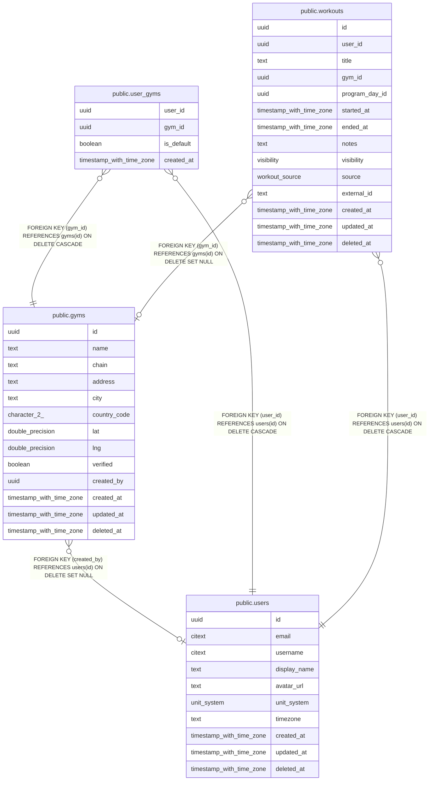

# Gyms

## Description

Gym directory and users' saved gyms.

## Tables

| Name | Columns | Comment | Type |
| ---- | ------- | ------- | ---- |
| [public.users](public.users.md) | 10 | Application accounts. Identity proof lives in auth_identities, not here. | BASE TABLE |
| [public.gyms](public.gyms.md) | 13 | Shared gym directory, e.g. "Golds Gym, Aundh". Plain lat/lng for now; PostGIS only if "gyms near me" needs it. | BASE TABLE |
| [public.user_gyms](public.user_gyms.md) | 4 | A user's saved gyms. Doubles as gym membership for later social features. | BASE TABLE |
| [public.workouts](public.workouts.md) | 14 | One training session. Day bucketing (heatmap, streaks) uses started_at in users.timezone. | BASE TABLE |

## Relations

---

> Generated by [tbls](https://github.com/k1LoW/tbls)
